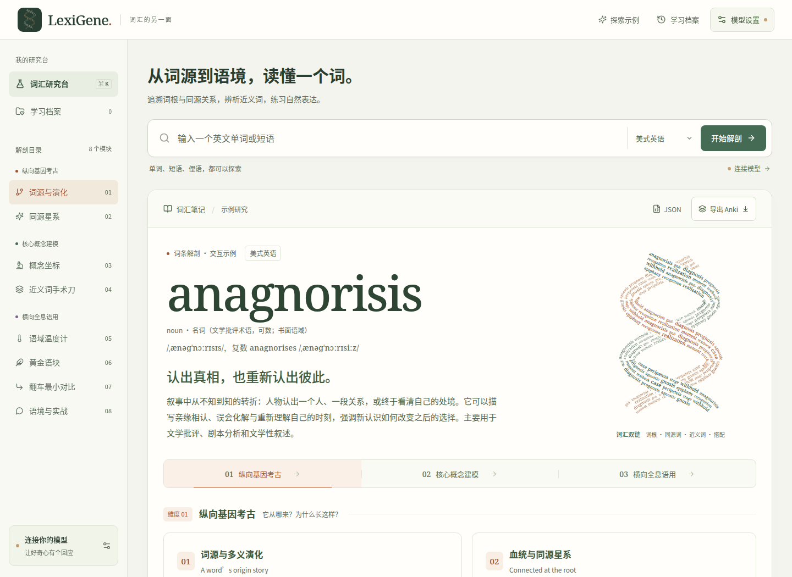
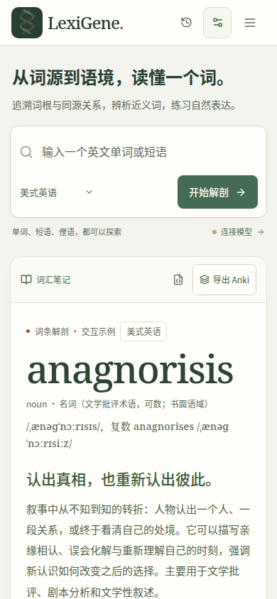

<p align="center">
  
</p>

<h1 align="center">LexiGene</h1>

<p align="center">
  <strong>Understand the word. Make it yours.</strong><br>
  A local-first English vocabulary desk, taught in Chinese.
</p>

<p align="center">
  <a href="https://github.com/lychen2/LexiGene/actions/workflows/build.yml"></a>
  <a href="LICENSE"></a>
  <a href="go.mod"></a>
</p>

<p align="center">
  <a href="https://github.com/lychen2/LexiGene/releases"><strong>Download</strong></a> ·
  <a href="#a-word-in-three-dimensions">Explore</a> ·
  <a href="#run-from-source">Run from source</a> ·
  <a href="docs/DEVELOPMENT.md">Build guide</a>
</p>



Go beyond a translation. Explore where an expression came from, what makes it distinctive, and how people use it.

The complete **anagnorisis** example works immediately. Connect an OpenAI-compatible model to explore your own words, phrases, and slang.

## A word in three dimensions

| Follow its origins | Find its meaning | Put it to work |
| --- | --- | --- |
| Trace etymology and meaning changes. Explore a constellation of related words. | Compare mental imagery and nearby synonyms in the same situation. | Adjust register, collect useful phrases, inspect pitfalls, and practise original sentences. |
| **Etymology · Cognates** | **Concept coordinates · Synonym comparison** | **Register · Chunks · Pitfalls · Dialogue and practice** |

- **See the connections.** Dense, curved words form a three-dimensional double helix from each entry’s roots, cognates, synonyms, and collocations.
- **Explore by doing.** Select evolution stages, compare synonyms, and move the register thermometer with mouse, touch, or keyboard.
- **Practise with context.** Reveal vocabulary hints and receive feedback on naturalness, register, and imagery.
- **Keep your progress.** Analyses, drafts, practice attempts, and card selections stay in local learning storage.
- **Build a lasting deck.** Select card previews and export Anki packages, TSV, or a complete JSON analysis.
- **Resume interrupted work.** Pause generation and continue with the missing dimensions while keeping completed results.

<details>
<summary><strong>The same desk on a smaller screen</strong></summary>

<p align="center">
  
</p>

</details>

## Get the app

Choose a package from [GitHub Releases](https://github.com/lychen2/LexiGene/releases).
For the latest branch build, open a successful [Actions run](https://github.com/lychen2/LexiGene/actions/workflows/build.yml) and download its artifact.

| Platform | Package | Architecture |
| --- | --- | --- |
| Linux | Debian package or tarball | amd64 |
| macOS | DMG or application ZIP | Universal: Apple Silicon and Intel |
| Windows | NSIS installer | amd64 |
| Android | Signed APK | arm64 devices and x86_64 emulators |

Installed applications use Go with a native desktop window or Android WebView. They need no Node server.
Desktop releases update themselves from signed GitHub releases; **Update → Check for Updates…** checks on demand. Android releases need a consistent signing key for in-place updates.

## Your first word

1. Open **模型设置** and enter your provider’s API Base URL and API Key.
2. Select **拉取模型**, then choose a model or enter its ID manually.
3. Select **测试连接**, then **保存设置**.
4. Enter an English expression and select **开始解剖**.
5. Open **学习档案** to revisit your notes, or choose **导出 Anki** to make flashcards.

For OpenAI, use `https://api.openai.com/v1`. Compatible providers can use their own API base or `/chat/completions` endpoint.

The English variety selector defaults to American English. Interface text, explanations, and practice feedback stay in Simplified Chinese.

## Local learning, your model

Learning records live in IndexedDB. API settings stay separate from learning records and exports.
Settings last for the current session unless you select **记住在本机**.

The local Go service forwards model requests and credentials to your configured provider without persisting those credentials.
English entry lookup also contacts Wiktionary for pronunciation, meanings, usage labels, and etymology.
Source headwords and sections distinguish the queried word from its historical relatives. The built-in example needs no model connection.

JSON transfers a complete analysis between browsers, desktop, and Android. Drafts, attempts, and card selections stay in their original storage profile.
Anki cards use stable note IDs, so repeat imports can update existing notes.

## Run from source

Use Go **1.27.3**, Node.js **22.12+**, and npm.
Linux desktop development also requires GTK 3 and WebKitGTK 4.1.

```sh
npm ci
npm run dev
```

For a browser preview:

```sh
npm run build:web
npm start
```

Open [127.0.0.1:3000](http://127.0.0.1:3000). The Go service listens on loopback.

| Task | Command |
| --- | --- |
| Package the desktop app | `npm run build` |
| Cross-build desktop apps | `npm run build:all` |
| Build the Android APK | `npm run build:android` |
| Check TypeScript | `npm run typecheck` |
| Run unit tests | `npm test` |
| Run Go tests | `npm run test:go` |
| Run browser acceptance | `npm run test:e2e` |

See the [development guide](docs/DEVELOPMENT.md) for platform dependencies, signing, APK validation, provider behaviour, and the code map.
Visual rules and responsive decisions live in [DESIGN.md](DESIGN.md).

## License

[MIT](LICENSE) for application code. The bundled Noto-derived reading font retains its [SIL Open Font License](public/fonts/ReadingFont-OFL.txt).
